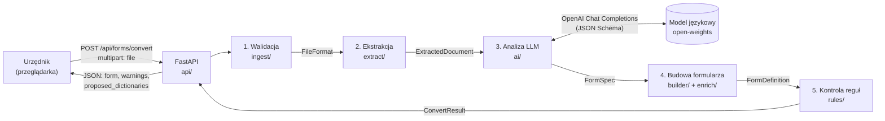
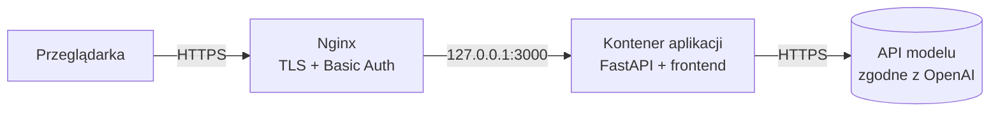

# Architektura rozwiązania

Dokument opisuje, jak aplikacja zamienia blankiet formularza (PDF, DOC/DOCX, ODS, XLSX, JPG/JPEG, PNG) na JSON
`FormDefinition` gotowy do importu w systemie docelowym. Instrukcja uruchomienia, konfiguracja i opis REST API są
w [README.md](../README.md).

## Widok ogólny

Jeden proces FastAPI udostępnia REST API pod `/api` i serwuje zbudowany frontend (React + Vite) pod `/`. Przesłany plik
przechodzi przez pięć etapów. Tylko jeden z nich, analiza treści, korzysta z modelu językowego. Pozostałe to
deterministyczny kod w Pythonie.

Etapy łączy [pipeline.py](../src/hacknation_2026/pipeline.py). Typy przekazywane między nimi są zdefiniowane
w [contracts.py](../src/hacknation_2026/contracts.py), więc każdy etap można testować osobno.

## Etapy przetwarzania

| # | Etap | Moduł | Wejście → wyjście | Jak działa |
|---|------|-------|-------------------|------------|
| 1 | Walidacja | `ingest/` | nazwa + bajty → `FileFormat` | Nazwa: do 250 znaków, bez `; : > < / \ \| ' * % $`. Rozmiar: limit `MAX_FILE_SIZE_MB`. Format rozpoznawany z zawartości (sygnatury plików, struktura ZIP/OLE2) i porównywany z rozszerzeniem. |
| 2 | Ekstrakcja | `extract/` | bajty → `ExtractedDocument` (bloki: tekst, tabele, pola wyboru, numery stron) | PDF: warstwa tekstowa (pdfplumber), dla skanów OCR. Obrazy: OCR Tesseract (`pol`) oraz OpenCV do wykrywania miejsc do wypełnienia (linie, kratki, pola wyboru). DOCX: XML dokumentu. DOC: odczyt binarny przez `olefile`. XLSX/ODS: komórki z obramowaniem jako pola. |
| 3 | Analiza LLM | `ai/` | tekst dokumentu → `FormSpec` | Model dostaje tekst i zwraca znaczenie formularza: strony, sekcje, pola, typy, opcje, warunki widoczności, zgody. Odpowiedź jest wymuszana schematem JSON i walidowana przez Pydantic. |
| 4 | Budowa | `builder/`, `enrich/` | `FormSpec` → `FormDefinition` | Kod nadaje strukturę zgodną ze schematem importu: siatkę, sekcje standardowe, słowniki, dane inicjalne, walidatory, warunki JSONata, przepływ stron i identyfikatory UUID. |
| 5 | Kontrola reguł | `rules/` | `FormDefinition` → lista naruszeń | Sprawdza wynik z Regułami technicznymi. Naruszenia trafiają do `warnings`; formularz jest zwracany mimo to, żeby urzędnik mógł go poprawić. |

Endpoint `POST /api/forms/extract` wykonuje tylko etapy 1–2. Frontend pokazuje odczytany tekst obok formularza
cyfrowego, bo przeglądarka nie wyświetli plików Word ani arkuszy, a przy skanach widać, co odczytał OCR.

## Podział pracy: model językowy a kod deterministyczny

Model odpowiada wyłącznie za **rozumienie treści**. Wszystko, co musi być zgodne ze specyfikacją, robi kod.

| Model językowy (`ai/`) | Kod deterministyczny (`builder/`, `enrich/`, `rules/`) |
|---|---|
| Rozpoznaje, czy plik jest formularzem do wypełnienia | Generuje identyfikatory UUID stron, pól i przejść |
| Ustala tytuł i adresata (urząd albo organ) | Rozmieszcza pola w siatce (`x`, `y`, `rows`, `cols`) |
| Dzieli treść na strony tematyczne i sekcje | Dodaje strony standardowe: „Dane”, „Kontakt i zgody”, „Strona końcowa” (`FINISH`) |
| Rozpoznaje pola, ich typy i opcje wyboru | Przypisuje słowniki (np. `Kraje`, `TERYT_4G_DOWODOWY`) i dane inicjalne (`PESEL`, `PESEL_ADDRESS`, `MLPZ`) |
| Wskazuje zależności („pokaż, gdy wybrano X”) | Zamienia zależności na wyrażenia JSONata w `states` |
| Wypisuje zgody i oświadczenia | Dobiera walidatory (`PESEL`, `NIP`, `REGON`, `ZIP_CODE`, `EMAIL`, …) i `readOnly` dla danych inicjalnych |
| | Proponuje nowe słowniki dla list wyboru, których nie ma w bazie |
| | Sprawdza wynik z Regułami technicznymi |

Dzięki temu podziałowi:

- **Wynik zawsze ma poprawną strukturę.** Model nie pisze JSON-u importu, więc nie może zgubić wymaganego klucza,
  podać złego typu ani powtórzyć identyfikatora.
- **Reguły są w jednym miejscu.** Specyfikacja z `dane_zadania/materialy/` jest zapisana w kodzie
  (`builder/standard_sections.py`, `enrich/catalog.py`, `initial_data.py`, `rules/check.py`). Zmiana reguły nie wymaga
  zmiany promptu.
- **Model można wymienić.** Klient (`ai/client.py`) mówi protokołem OpenAI Chat Completions, więc działa z każdym
  serwerem zgodnym z tym API, także uruchomionym lokalnie (np. vLLM, llama.cpp, Ollama).
- **Mniej tokenów.** Model dostaje tylko tekst dokumentu i zwraca zwarty `FormSpec`, a nie pełny `FormDefinition`.

### Odporność na błędy modelu

- Odpowiedź niezgodna ze schematem: jedna ponowna próba z treścią błędu walidacji.
- Niepełna odpowiedź przy długich formularzach: kod porównuje miejsca do wypełnienia w dokumencie z odpowiedzią modelu
  i, gdy brakuje dużej części, dopytuje tylko o pominięte strony.
- Warunek wskazujący nieistniejącą opcję: kod dopasowuje go do najbliższej istniejącej opcji pola sterującego.
- Limit zapytań (HTTP 429): ponowienie z rosnącym odstępem albo przełączenie na `LLM_FALLBACK_MODEL`.
- Plik, który nie jest formularzem (cennik, instrukcja, program wydarzenia): odpowiedź `422 NOT_A_FORM`, bez generowania
  formularza.

## Źródła reguł

Kod opiera się na dokumentach z `dane_zadania/materialy/`:

| Dokument | Gdzie w kodzie |
|---|---|
| Reguły techniczne konfiguracji formularzy | `rules/check.py`, `builder/layout.py`, `builder/jsonata.py` |
| Opis importowanego pliku JSON i `importowanyPlikJsonSchemat` | `builder/layout.py` (kształt węzłów) |
| Standardy i dobre praktyki projektowania formularzy | `builder/standard_sections.py`, reguły w `enrich/catalog.py` |
| Słowniki | `enrich/catalog.py` |
| Dane inicjalne | `initial_data.py`, `enrich/catalog.py` |

Gdy przykładowe JSON-y (formularze 1 i 5) różnią się od specyfikacji, decyduje specyfikacja. Każde odstępstwo
od przykładu jest wymienione w testach razem z uzasadnieniem (`SPEC_OVERRIDES`, `KNOWN_REFERENCE_VIOLATIONS`).

## REST API

| Metoda i ścieżka | Opis |
|---|---|
| `POST /api/forms/convert` | Plik w polu `file` → `form` (`FormDefinition`), `warnings`, `proposed_dictionaries` |
| `POST /api/forms/extract` | Plik w polu `file` → tekst odczytany z pliku (bez modelu) |
| `GET /api/health` | Stan aplikacji i dostępność modelu |
| `GET /docs` | Interaktywna dokumentacja OpenAPI |

Błędy mają postać `{"code": "...", "message": "..."}`:

| Kod | HTTP | Przyczyna |
|---|---|---|
| `INVALID_FILENAME` | 422 | Brak nazwy, nazwa dłuższa niż 250 znaków albo niedozwolone znaki |
| `UNSUPPORTED_FORMAT` | 415 | Rozszerzenie spoza listy obsługiwanych |
| `MIME_MISMATCH` | 415 | Zawartość pliku nie odpowiada rozszerzeniu |
| `FILE_TOO_LARGE` | 413 | Plik większy niż `MAX_FILE_SIZE_MB` |
| `UNREADABLE_FILE` | 422 | Uszkodzony plik |
| `EMPTY_DOCUMENT` | 422 | Nie udało się odczytać tekstu |
| `NOT_A_FORM` | 422 | Dokument nie jest formularzem do wypełnienia |
| `LLM_INVALID_RESPONSE`, `LLM_ERROR` | 502 | Model nie zwrócił poprawnej odpowiedzi |
| `LLM_UNAVAILABLE` | 503 | Brak połączenia z modelem albo przekroczony `LLM_TIMEOUT_S` |
| `LLM_CONFIG` | 500 | Błędna konfiguracja modelu |

## Frontend

Aplikacja React w `frontend/`, budowana przez Vite do `src/hacknation_2026/static/` i serwowana przez FastAPI.
Ścieżki aplikacji (`/digitalize`, `/verify`) zwracają `index.html`, więc odświeżenie strony działa.

1. **Import** (`/`): wybór jednego lub wielu plików; kolejne pliki można przypisać do tego samego formularza albo
   rozpocząć nowy.
2. **Cyfryzacja** (`/digitalize`): pliki są wysyłane po kolei do `/api/forms/convert`, z postępem i ponowieniem.
3. **Weryfikacja** (`/verify`): obok siebie oryginał, podgląd formularza eUsługi i JSON. Urzędnik widzi ostrzeżenia
   i proponowane słowniki, może poprawić JSON i pobrać wynik.

Pliki zostają tylko w pamięci karty przeglądarki; wyniki z poprawkami urzędnika trafiają do `sessionStorage`.
Menu dostępności pozwala zmienić rozmiar tekstu, włączyć wysoki kontrast i szerszy odstęp tekstu.

## Wdrożenie

- **Obraz Docker** budowany wieloetapowo ([Dockerfile](../Dockerfile)): etap `node:24-alpine` buduje frontend,
  etap `python:3.14.10-slim-trixie` instaluje zależności przez `uv sync --frozen` i Tesseract z językiem polskim.
  Obraz `slim` zamiast Alpine wynika z tego, że OpenCV i NumPy mają gotowe pakiety tylko dla glibc; na Alpine (musl)
  trzeba by je kompilować.
- **Uruchomienie:** proces działa jako nieuprzywilejowany użytkownik `appuser`, obraz udostępnia tylko port 3000,
  a `HEALTHCHECK` odpytuje `/api/health`.
- **Konfiguracja i sekrety** trafiają do kontenera dopiero przy uruchomieniu (zmienne środowiskowe, `.env`).
  `.dockerignore` wyklucza `.env` z obrazu.
- **Docker Compose** wystawia port tylko na `127.0.0.1`; ruch z zewnątrz przechodzi przez reverse proxy.
- **CI/CD:** GitHub Actions ([deploy.yml](../.github/workflows/deploy.yml)) po każdym pushu na `main` łączy się przez SSH
  z serwerem i przebudowuje kontener (`docker compose up -d --build`).
- **Środowisko demonstracyjne:** [hacknation.zakhil.dev](https://hacknation.zakhil.dev), za Nginx z Basic Auth.

## Bezpieczeństwo i przetwarzanie danych

- **Pliki nie są zapisywane.** Plik jest czytany do pamięci (najwyżej `MAX_FILE_SIZE_MB` + 1 bajt, więc zbyt duży plik
  nie jest wczytywany w całości) i przetwarzany w pamięci (`io.BytesIO`). Aplikacja nie ma bazy danych, nie zapisuje
  plików na dysk ani ich nie loguje. Po zakończeniu żądania nic nie zostaje.
- **Walidacja przed przetwarzaniem:** nazwa, rozmiar i format z zawartości są sprawdzane, zanim plik trafi do parserów.
- **Dane wysyłane do modelu:** do API modelu trafia tylko tekst odczytany z blankietu, a nie sam plik. Blankiety to puste
  formularze, bez danych osobowych. Przy modelu uruchomionym we własnej infrastrukturze tekst nie opuszcza sieci urzędu.
- **Kontener:** użytkownik bez uprawnień administratora, jawnie wersjonowane oficjalne obrazy bazowe, tylko wymagany port,
  sekrety tylko w czasie uruchomienia.
- **Dostęp:** w środowisku demonstracyjnym chroni go Basic Auth na reverse proxy.

## Testy i jakość

- `uv run pytest`: testy jednostkowe każdego etapu oraz testy całego API; wywołania modelu są mockowane, więc testy
  nie potrzebują sieci.
- Testy porównują wynik dla formularzy 1 i 5 z przykładowymi JSON-ami i sprawdzają wszystkie formularze
  z Regułami technicznymi.
- `scripts/evaluate.py` przetwarza wszystkie blankiety z `dane_zadania/blankiety/` z prawdziwym modelem. Zapisuje wyniki
  do `wyniki/` i raport do `wyniki/raport.json`: liczbę pól, naruszenia reguł, czas, zgodność pól między formatami tego
  samego formularza i podobieństwo do przykładów.
- Frontend: `npm run lint` (oxlint).

## Zależności i licencje

Wszystkie zależności są open source i nie wymagają licencji komercyjnych. Kod aplikacji jest na licencji MIT
([LICENSE](../LICENSE)).

| Obszar | Biblioteki | Licencje |
|---|---|---|
| API | FastAPI, Starlette, Uvicorn, Pydantic, pydantic-settings, python-multipart, HTTPX | MIT, BSD-3-Clause, Apache-2.0 |
| Ekstrakcja | pdfplumber, pdfminer.six, pypdfium2, olefile, openpyxl, lxml | MIT, BSD, Apache-2.0 |
| OCR i obraz | Tesseract, pytesseract, OpenCV, NumPy, Pillow | Apache-2.0, BSD-3-Clause, MIT-CMU |
| Frontend | React, React Router, Tailwind CSS, Base UI, Vite | MIT |

Dwie zależności pośrednie mają licencję MPL-2.0 (słaby copyleft na poziomie pliku): `certifi` (certyfikaty CA dla HTTPS)
i `lightningcss` (tylko podczas budowania frontendu). MPL-2.0 wymaga publikacji jedynie zmian w samych plikach tych
bibliotek; projekt ich nie modyfikuje, więc nie dotyczy to kodu aplikacji.

Do konwersji DOC nie użyto LibreOffice: format binarny jest czytany bezpośrednio przez `olefile`, bez zewnętrznego procesu.

## Ograniczenia

- Jakość wyniku dla skanów zależy od OCR: odręczne dopiski i słaba jakość skanu obniżają rozpoznanie pól.
- Model może dać nieco inny podział na strony przy kolejnych uruchomieniach; aplikacja używa `temperature: 0`,
  a wynik zawsze przechodzi przez tę samą deterministyczną budowę i kontrolę reguł.
- Wynik jest propozycją do weryfikacji przez urzędnika: ostrzeżenia z kontroli reguł wskazują miejsca do poprawy.
