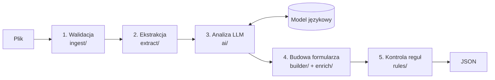

# Architektura rozwiązania

Aplikacja zamienia blankiet formularza na JSON z konfiguracją formularza gotową do importu. Jeden proces FastAPI udostępnia
REST API pod `/api` i serwuje frontend (React) pod `/`. Uruchomienie, konfiguracja i opis API: [README.md](../README.md).

## Przepływ przetwarzania

| Etap | Co robi |
|---|---|
| 1. Walidacja | Sprawdza nazwę, rozmiar i format pliku rozpoznany z zawartości |
| 2. Ekstrakcja | Odczytuje tekst, tabele i miejsca do wypełnienia: pdfplumber (PDF), XML (DOCX), olefile (DOC), openpyxl/lxml (XLSX, ODS), Tesseract + OpenCV (skany i obrazy) |
| 3. Analiza LLM | Model zwraca opis formularza: strony, sekcje, pola, typy, opcje, zależności, zgody. Odpowiedź jest wymuszana i sprawdzana schematem JSON |
| 4. Budowa | Kod buduje JSON do importu: siatkę pól, strony standardowe, słowniki, dane inicjalne, walidatory, warunki JSONata, przepływ stron, UUID |
| 5. Kontrola reguł | Sprawdza wynik z Regułami technicznymi; naruszenia trafiają do `warnings` |

Model językowy odpowiada tylko za rozumienie treści formularza. Strukturę wyniku i zgodność ze specyfikacją
(`dane_zadania/materialy/`) zapewnia kod deterministyczny. Dlatego JSON zawsze ma poprawną strukturę, a reguły są
w jednym miejscu, a nie w prompcie.

## Realizacja wymagań technicznych (pkt 5)

| Wymaganie | Realizacja |
|---|---|
| Język | Python 3.14 (backend), JavaScript (frontend) |
| Biblioteki open source, bez copyleftu i licencji komercyjnych | FastAPI, Uvicorn, Pydantic, pdfplumber, pypdfium2, olefile, openpyxl, lxml, OpenCV, Tesseract, React, Vite (MIT, BSD, Apache-2.0). Dwie zależności pośrednie mają MPL-2.0 (`certifi`, `lightningcss` przy budowaniu frontendu); używamy ich bez zmian, więc nie trzeba publikować kodu. Kod projektu: [MIT](../LICENSE) |
| Model LLM nie tylko przez API | `google/gemma-4-31b-it` ma otwarte wagi. Klient używa protokołu OpenAI Chat Completions, więc model można uruchomić lokalnie (vLLM, llama.cpp, Ollama), zmieniając tylko `LLM_BASE_URL` |
| REST API, pojedynczy plik | `POST /api/forms/convert`, plik w polu `file` |
| Formaty wejściowe | `.pdf`, `.doc`, `.docx`, `.ods`, `.xlsx`, `.jpg`, `.jpeg`, `.png` |
| Wynik | JSON zgodny z `importowanyPlikJsonSchemat`, gotowy do importu |
| Walidacja typu pliku | Format rozpoznawany z zawartości (sygnatury PDF, PNG, JPEG, OLE2 i struktura ZIP dla DOCX, XLSX, ODS) i porównywany z rozszerzeniem; niezgodność daje `415 MIME_MISMATCH` |
| Walidacja nazwy pliku | Do 250 znaków, bez `; : > < / \ \| ' * % $`; inaczej `422 INVALID_FILENAME` |
| Walidacja rozmiaru | Limit `MAX_FILE_SIZE_MB` (domyślnie 10); wczytywane jest najwyżej limit + 1 bajt; większy plik daje `413 FILE_TOO_LARGE` |
| Przechowywanie plików | Plik jest tylko w pamięci żądania (`io.BytesIO`). OCR przekazuje obraz do Tesseract przez plik tymczasowy, usuwany w trakcie żądania. Brak bazy danych i zapisu plików |
| Konteneryzacja | [Dockerfile](../Dockerfile) (wieloetapowy) i [docker-compose.yml](../docker-compose.yml) |
| Oficjalne, lekkie, wersjonowane obrazy, bez `latest` | `node:24-alpine` (budowanie frontendu), `python:3.14.10-slim-trixie` (aplikacja). Obraz `slim` zamiast Alpine, bo OpenCV i NumPy mają gotowe pakiety tylko dla glibc |
| Użytkownik z ograniczonymi uprawnieniami | Proces działa jako `appuser` |
| Tylko wymagane porty | `EXPOSE 3000`; Compose publikuje go tylko na `127.0.0.1` |
| Sekrety w czasie uruchomienia | Zmienne środowiskowe lub `--env-file`; `.dockerignore` wyklucza `.env` z obrazu |
| Konfiguracja | Zmienne środowiskowe: rozmiar pliku (`MAX_FILE_SIZE_MB`), parametry modelu (`LLM_*`), OCR (`OCR_LANG`); tabela w README |
| Dokumentacja | [README.md](../README.md): budowanie obrazu, uruchomienie, konfiguracja, REST API |

## Rozszerzenia opcjonalne (pkt 3.3)

| Rozszerzenie | Realizacja |
|---|---|
| I. Słowniki i dane inicjalne | `enrich/`, `initial_data.py`. Słowniki trafiają do list wyboru (np. `Kraje`, `TERYT_4G_DOWODOWY`). Dane inicjalne `PESEL`, `PESEL_ADDRESS` i `MLPZ` zasilają dane wnioskodawcy i są tylko do odczytu, z wyjątkiem telefonu i e-maila |
| II. Nowy słownik | `proposed_dictionaries` w odpowiedzi API: nazwa, przykładowe wartości i pola, które by z niego korzystały |
| III. Zależności i przepływy | Widoczność pól i sekcji zależna od wyborów użytkownika jako wyrażenia JSONata w `states`; przejścia między stronami w `flow.links` |
| IV. Frontend do importu | Wybór wielu plików, postęp przetwarzania, podgląd i pobranie JSON-u |
| V. Wizualizacja formularza | Ekran weryfikacji: oryginał, podgląd formularza eUsługi i JSON obok siebie, z możliwością edycji JSON-u |
| VI. Walidacje i UX | Walidatory `REQUIRED`, `PESEL`, `NIP`, `REGON`, `ZIP_CODE`, `EMAIL`; przetwarzanie wielu plików naraz (batch); ostrzeżenia z kontroli Reguł technicznych |

## Wdrożenie

- Demo [hacknation.zakhil.dev](https://hacknation.zakhil.dev): Nginx (HTTPS, Basic Auth), za nim kontener aplikacji
  na `127.0.0.1:3000`. Aplikacja łączy się z API modelu (Eden AI).
- GitHub Actions ([deploy.yml](../.github/workflows/deploy.yml)) po każdym pushu na `main` przebudowuje kontener
  na serwerze.
